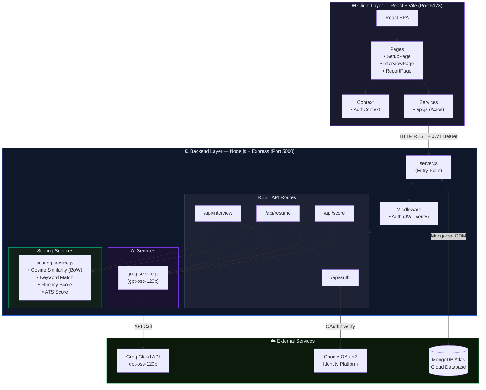
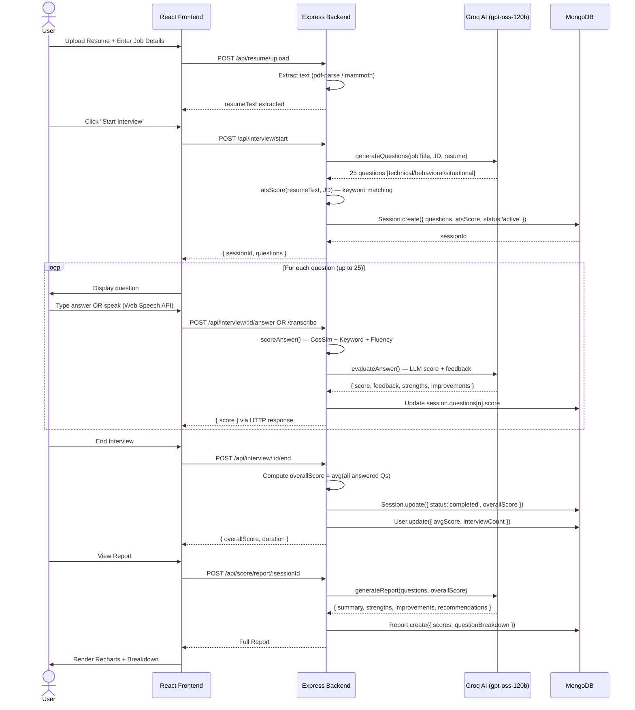
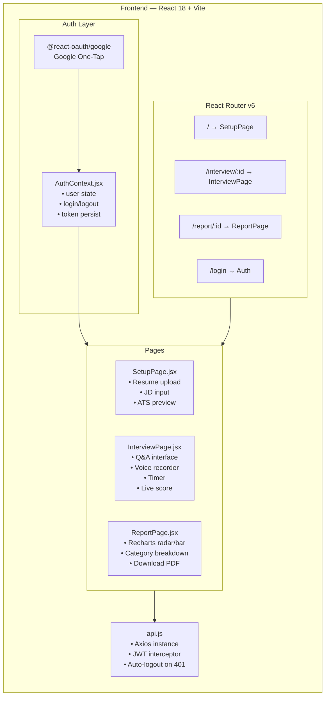
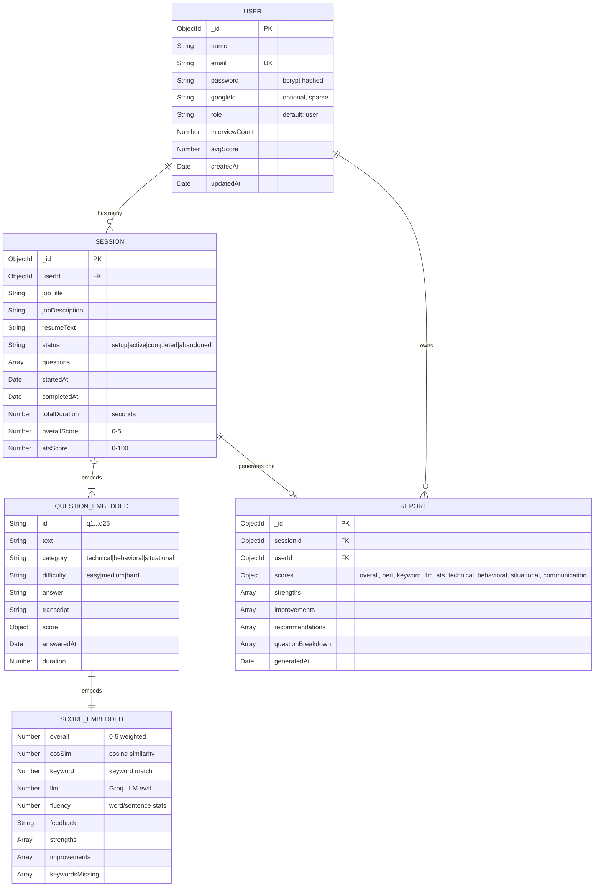
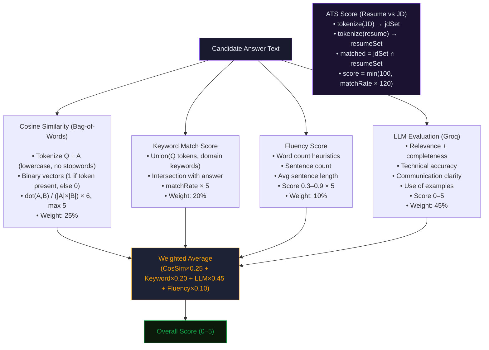
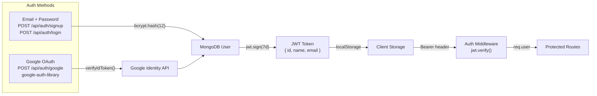

# InterviewAI — System Architecture & Design
>InterviewAI is a full-stack MERN web application that acts as an **AI-powered mock interview coach.** Users can upload their resume, paste a job description, and then get interviewed by it — either by speaking or typing. After finishing, they receive a **detailed report with scores and feedback.**
---

## 📐 High-Level Architecture Overview



---

## 🔄 Interview Session Flow



---

## 🏗️ Component Architecture



---

## 🗄️ Database Schema Design



---

## 🧠 Scoring Engine Design



---

## 🔐 Authentication Flow



---

## 📦 Technology Stack Summary

| Layer | Technology | Purpose |
|---|---|---|
| **Frontend Framework** | React 18 + Vite | SPA with fast HMR dev server |
| **Routing** | React Router v6 | Client-side navigation |
| **HTTP Client** | Axios | REST API calls + interceptors |
| **Auth** | @react-oauth/google | Google One-Tap login |
| **Charts** | Recharts | Score visualization |
| **Backend** | Node.js + Express 4 | REST API server |
| **Database** | MongoDB + Mongoose | Document store |
| **Auth** | JWT + bcryptjs | Token-based auth + password hashing |
| **Google Auth** | google-auth-library | OAuth2 token verification |
| **AI** | Groq SDK (openai/gpt-oss-120b) | Question gen, answer eval, report gen |
| **Resume Parsing** | pdf-parse + mammoth | Extract text from PDF/DOCX |
| **File Upload** | Multer | Memory-buffered multipart upload |
| **Dev Server** | Nodemon | Auto-reload backend |

---

## 📂 Project Directory Structure

```
ai-mock-interview/
├── frontend/                          # React + Vite SPA
│   ├── src/
│   │   ├── App.jsx                    # Root + router config
│   │   ├── main.jsx                   # React DOM entry
│   │   ├── index.css                  # Global styles
│   │   ├── context/
│   │   │   └── AuthContext.jsx        # Auth state provider
│   │   ├── pages/
│   │   │   ├── SetupPage.jsx          # Step 1: Resume + JD input
│   │   │   ├── InterviewPage.jsx      # Step 2: Q&A session
│   │   │   └── ReportPage.jsx         # Step 3: Results + charts
│   │   ├── services/
│   │   │   └── api.js                 # Axios + all API methods
│   │   └── hooks/                     # Custom React hooks
│   ├── index.html
│   ├── vite.config.js
│   └── vercel.json                    # Vercel deployment config
│
└── backend/                           # Node.js + Express server
    ├── server.js                      # App bootstrap
    ├── index.js                       # Alt entry (dev)
    ├── middleware/
    │   └── auth.js                    # JWT protect middleware
    ├── models/
    │   └── index.js                   # User, Session, Report schemas
    ├── routes/
    │   ├── auth.js                    # /api/auth/*
    │   ├── interview.js               # /api/interview/*
    │   ├── resume.js                  # /api/resume/*
    │   └── score.js                   # /api/score/*
    └── services/
        ├── ai/
        │   ├── groq.service.js        # LLM functions (Groq SDK)
        │   └── whisper.service.js     # (Speech-to-text stub)
        └── scoring/
            ├── scoring.service.js     # Hybrid scoring engine
            └── score.js               # Score utilities
```

---

## 🌐 API Endpoint Map

| Method | Endpoint | Auth | Description |
|---|---|---|---|
| `POST` | `/api/auth/signup` | ❌ | Register with email + password |
| `POST` | `/api/auth/login` | ❌ | Login with email + password |
| `POST` | `/api/auth/google` | ❌ | Google OAuth2 login |
| `GET` | `/api/auth/me` | ✅ | Get current user profile |
| `POST` | `/api/resume/upload` | ✅ | Upload PDF/DOCX resume → extract text |
| `POST` | `/api/resume/analyze` | ✅ | AI analysis of resume vs JD |
| `POST` | `/api/interview/start` | ✅ | Generate questions + create session |
| `GET` | `/api/interview/` | ✅ | List all sessions (last 20) |
| `GET` | `/api/interview/:id` | ✅ | Get single session details |
| `POST` | `/api/interview/:id/answer` | ✅ | Submit typed answer + score |
| `POST` | `/api/interview/:id/transcribe` | ✅ | Submit voice transcript + score |
| `POST` | `/api/interview/:id/end` | ✅ | Finalize session + compute score |
| `POST` | `/api/score/report/:id` | ✅ | Generate AI report for session |
| `GET` | `/api/score/report/:id` | ✅ | Fetch existing report |
| `POST` | `/api/score/ats-check` | ✅ | Standalone ATS keyword check |
| `GET` | `/api/score/history` | ✅ | Get user's report history |
| `GET` | `/api/health` | ❌ | Server + DB health check |

---

## 🔑 Key Design Decisions

| Decision | Choice | Rationale |
|---|---|---|
| **AI Model** | gpt-oss-120b via Groq | Fast inference, free tier, high quality |
| **Scoring** | Hybrid (CosSim + Keyword + LLM + Fluency) | Uses bag-of-words cosine similarity. Resilience if LLM fails; multi-dimensional. |
| **DB Design** | Questions embedded in Session | Avoids joins; answers are always queried with session |
| **Auth** | JWT (7d) in localStorage | Stateless, simple; trade-off: no server-side revoke |
| **File Upload** | Multer memory storage | No disk I/O; text extracted and discarded immediately |
| **Frontend Build** | Vite | Sub-second HMR, ESM native, fast prod builds |
| **Resume Parsing** | pdf-parse + mammoth | Handles both PDF and DOCX without cloud dependency |
